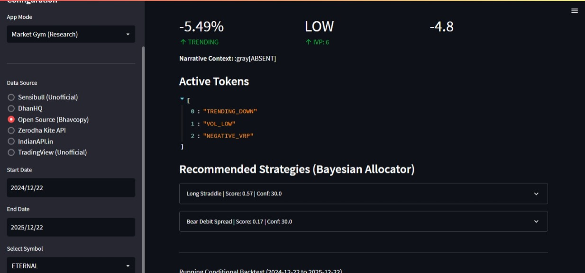
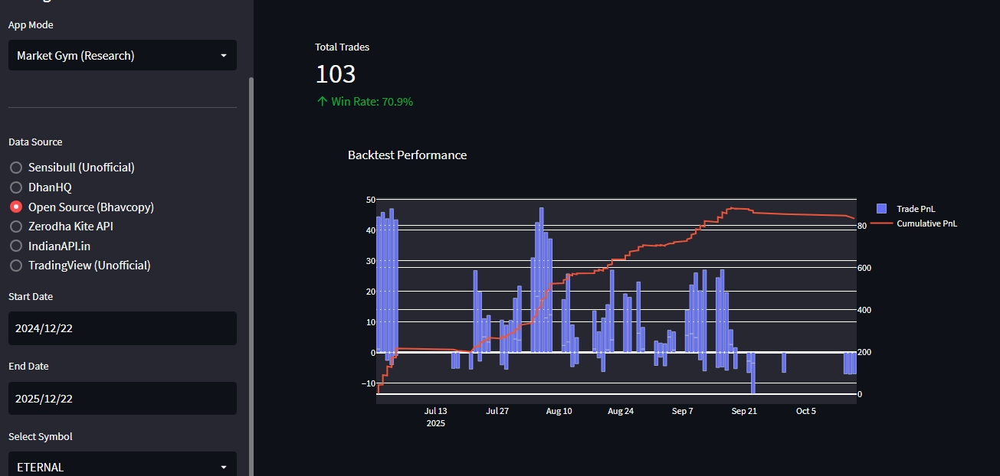

# Options Trading Dashboard (Demo)

A comprehensive, modular dashboard for analyzing options market data, identifying regimes, and generating strategy recommendations using a hybrid approach of classical technical analysis and novel "Narrative" context.

## Screenshots

| Dashboard View | Market Gym View |
|:---:|:---:|
|  |  |

## Features

- **Multi-Source Data Loading**: Supports NSE Bhavcopy (UDiFF & Legacy), Zerodha Kite, DhanHQ, and more.
- **Advanced Market State Analysis**:
    - **Regime Detection**: Automatically classifies market into Trending/Ranging and Low/High Volatility.
    - **Guardrails**: Enforces strict causality to prevent look-ahead bias in backtests.
    - **Narrative Awareness**: Integrates external signals (News, Events) into the decision framework.
- **Strategy Backtesting**: Simulate strategies like Iron Condor, Straddles, and Spreads against historical data.
- **Active Learning System (Experimental)**:
    - **Context Encoder**: Uses a transformer-based model to learn "Token Attention" — which market factors matter most for distinct strategies.
    - **Tokenization**: Converts complex market states into discrete, interpretable tokens (e.g., `VOL_HIGH`, `TRENDING_UP`).

> [!WARNING]
> **API Disclaimer**: Some data sources included (e.g., Sensibull, TradingView) effectively use unofficial APIs. They are provided for demonstration purposes and may break at any time or violate Terms of Service. Use official APIs (DhanHQ, Kite) for reliability.

> [!NOTE]
> **IV Data Availability**: Implied Volatility (IV) data is strictly calculated using Black-Scholes models on NSE Options Chain data (Bhavcopy). Some external APIs (like IndianAPI, Dhan) do not currently provide historical IV data, so volatility features may be limited for those sources.

## Installation

1.  **Clone the repository**:
    ```bash
    git clone https://github.com/athens556/options-dashboard.git
    cd options-dashboard
    ```

2.  **Install Dependencies**:
    ```bash
    pip install -r requirements.txt
    ```

3.  **Environment Setup**:
    - Copy `.env.example` to `.env`:
        ```bash
        cp .env.example .env
        ```
    - Fill in your API keys (DhanHQ, etc.) in the `.env` file.

## Usage

Run the Streamlit application:

```bash
streamlit run app.py
```

## Project Structure

- **`modules/dashboard`**: Core business logic (Market State, Backtest, Strategy).
- **`modules/api`**: Data fetching adapters (NSE, Dhan, Kite).
- **`modules/ml`**: Machine learning components (Tokenization, Context Encoder).
- **`tests`**: Verification scripts.

## Disclaimer

This project is a **DEMO** and is intended for educational and research purposes only. It is **not** financial advice. Trading options involves significant risk.

## License

MIT
